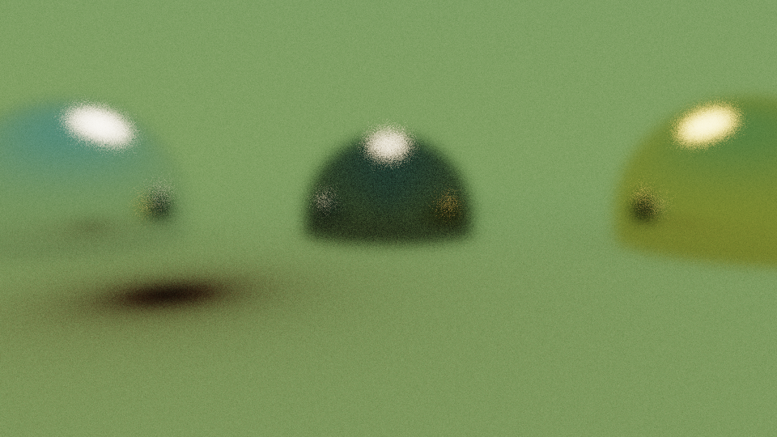
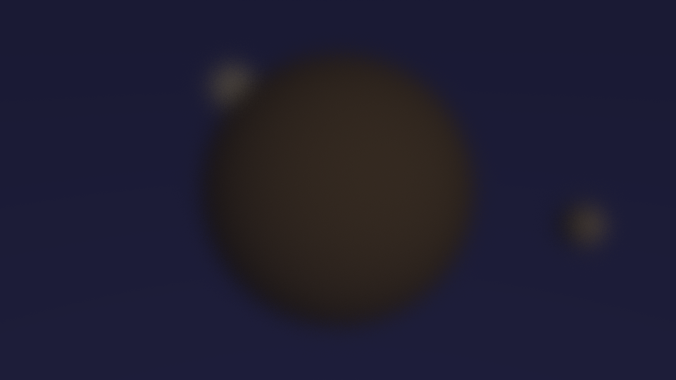

# 💡 ray-cinema

**EN:** A physically-based **Monte Carlo path tracer**, written from scratch in vectorized NumPy — no rendering libraries. JSON in, physically-plausible light out: glass that refracts with Snell's law and Schlick Fresnel, metal that blurs with roughness, emissive spheres, thin-lens depth of field, ACES tone mapping.

**TR:** JSON tanımlı sahneleri Monte Carlo path tracing ile render eden, sıfırdan yazılmış fiziksel ışık taşıma motoru — render kütüphanesi yok, her şey NumPy vektörize. Snell kırılması ve Schlick Fresnel'li cam, pürüzlülüklü metal, yayıcı küreler, ince lens alan derinliği, ACES tonemap.



> Blender projesi hazır render motorunu KULLANDI; bu repo motoru YAZDI. Serinin o eksik halkası burada kapanıyor.

## 🖼️ Gallery / Galeri

### 🥃 Glass & Metal — [`scenes/glass.json`](scenes/glass.json)
Cam küre, altın ve krom; ince-lens alan derinliği ile. — *Dielectric, gold and chrome spheres with thin-lens DOF.*

### 🎞️ Turntable / Dönen Kamera — `--turntable 12`

The same glass scene filmed from 12 orbiting angles — one JSON, one flag, one GIF. — *Aynı cam sahnesi, 12 yörünge açısından — tek JSON, tek bayrak, tek GIF.*

### 🪐 Planet — [`scenes/planet.json`](scenes/planet.json)

Uzayda kayalık gezegen, iki uydu ve arkadan aydınlatılmış uzak bir yıldız. — *Uzayda kayalık gezegen, arkadan aydınlatılan uzak yıldız.*

## 🧱 How it works / Nasıl çalışır

| Bileşen | Detay |
|---|---|
| ☀️ Transport | Monte Carlo path tracing: bounce başına küresel örneklem, throughput çarpımı |
| 💎 Materials | Lambertian (diffuse) · Metal (roughness'lı yansıma) · Dielectric (Snell + Schlick Fresnel + total iç yansıma) · Emissive |
| 🎥 Camera | İnce lens: apertür diski + odak mesafesi → gerçek alan derinliği; jitter'lı AA |
| 🎨 Film | ACES yaklaşık tonemap + gamma; 16-bit PNG |

## ✅ Verification / Doğrulama — körüne render yok

**EN:** A renderer's output *looks* plausible even when wrong — so we don't trust eyes. `tests/verify.py` checks analytically-known values: 45° mirror reflection, normal-incidence refraction invariance, Fresnel boundary values (r₀ = 0.04 at n=1.5, →1.0 at grazing) and monotonicity, the sky-gradient **vertically flipped in a curved mirror**, plus determinism (same seed → identical image). The Fresnel gate caught a real bug during development: the parallel refraction component was never multiplied by the surface normal.

**TR:** Render motorunun çıktısı yanlışken bile "inandırıcı" görünür — bu yüzden göze güvenilmez. `tests/verify.py` analitik bilinen değerleri denetler: 45° ayna yansıması, dik gelen ışında kırılmanın değişmemesi, Fresnel sınır değerleri (n=1.5 için r₀=0.04, sıfır açıda 1.0) ve monotonluk, gökyüzü gradyanının **eğik aynada dikey çevrilmesi**, determinizm. Fresnel kapısı geliştirme sırasında gerçek bir bug yakaladı: kırılmanın paralel bileşeni normalla çarpılmıyordu.

```bash
python3 tests/verify.py    # 9 fiziksel doğrulama kapısı
```

## 🚀 Usage / Kullanım

```bash
pip install numpy        # tek bağımlılık
# GIF için ffmpeg

python3 ray.py --scene scenes/glass.json              # tam kalite
python3 ray.py --scene scenes/glass.json --preview    # 320p hızlı deneme
python3 ray.py --scene scenes/glass.json --turntable 12   # 12 karelik GIF
```

## 🎛️ Everything is a parameter / Her şey parametre

```jsonc
{
  "render": { "width": 960, "height": 540, "spp": 120, "max_depth": 8, "exposure": 0.85 },
  "sky":    { "top": [0.55, 0.75, 1.0], "bottom": [1.0, 0.85, 0.6], "strength": 0.75 },
  "camera": { "position": [0, 1.1, -4.2], "look_at": [0, 0.6, 0],
              "vfov": 40, "aperture": 0.06, "focus_distance": 4.2 },
  "objects": [
    { "center": [0, 0.6, 0], "radius": 0.6,
      "material": { "type": "dielectric", "ior": 1.5 } },       // lambertian | metal | dielectric | emissive
    { "center": [0, 12, 4], "radius": 2.5,
      "material": { "type": "emissive", "albedo": [1, 0.85, 0.6], "emission": 14 } }
  ]
}
```

## 🧪 Why / Neden

**TR:** "Path tracer yazdım" demek 200 satırlık Python örneği kopyalamak olabilir. Bu projenin farkı: motor **vektörize** (ışın demetleri matris işlemleriyle, döngü yerine), **JSON sürücü** ve **kanıtlı** — Fresnel monotonluğundan aynadaki gradyan çevirmesine kadar 9 analitik kapı. Bir bileşik faiz gibi: her satır kendini doğrulayan sistemin parçası.

## 📄 License

MIT
